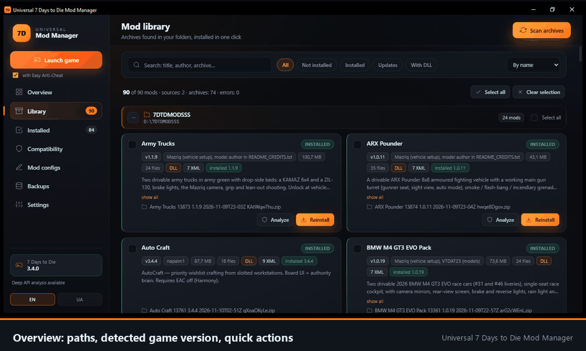
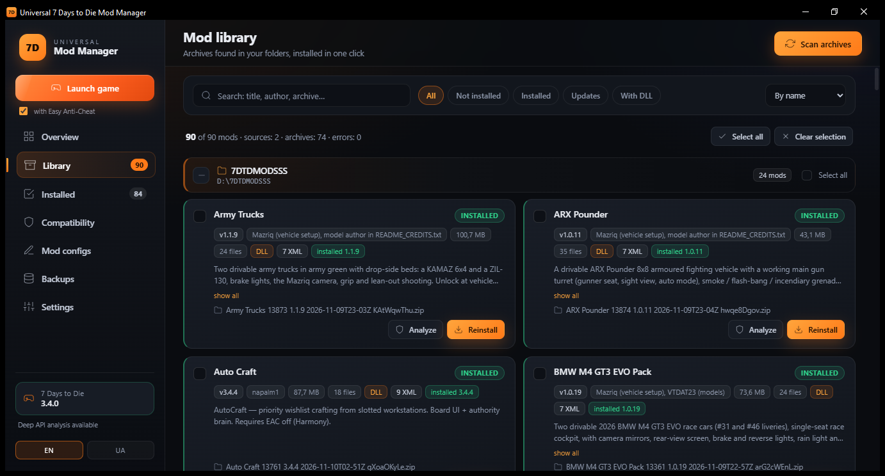
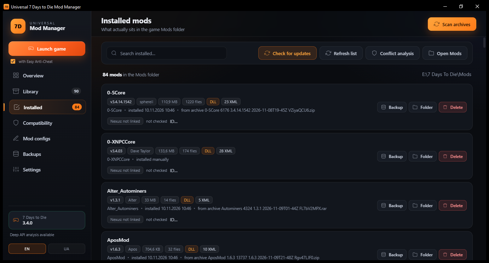
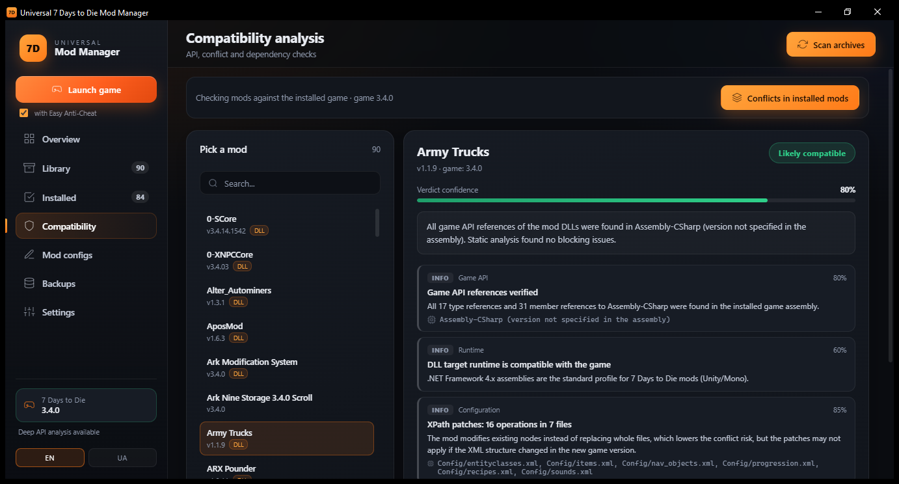
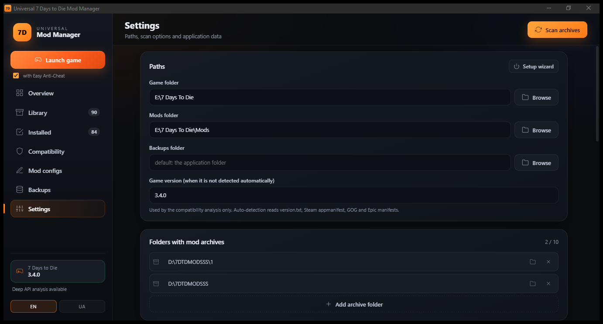

Universal 7 Days to Die Mod Manager
===================================

A Windows tool that keeps a mod archive library, the installed mods and the compatibility check in one
place. The part worth reading the source for is the conflict analysis: it does not compare file names,
it replays the actual XPath patches on a copy of the game config in load order and reports what really
happens to each node.

Download: see the [Releases](../../releases) page. Installation steps for regular users are in
[INSTALL.md](INSTALL.md), version history in [CHANGELOG.md](CHANGELOG.md).

This repository exists so the released executable can be verified. The binary is built from this source
with the commands below and nothing else is added to it.

What it does
------------

- Scans folders with mod archives (ZIP, 7Z, RAR, TAR, GZ, BZ2, XZ) and reads ModInfo from them.
- Installs, updates and removes mods in the game's Mods folder, always making a backup first.
- Analyses compatibility per mod: real DLL references to the game assembly, Harmony patches, target
  runtime, XML structure, declared dependencies.
- Compares mods on the node level and sorts the findings into conflict, potential issue, overlap and
  shared change.
- Writes conflict resolutions as a separate patch mod, never editing the original mods.
- Edits mod config values with a copy of the file made before writing.
- Starts the game with Easy Anti-Cheat on or off.

Interface in English and Ukrainian. The manager never downloads mods and never sends anything except
Nexus API requests made with the user's own key.

Screenshots
-----------

| | |
|---|---|
|  |  |
| Every archive is read, name and version come from ModInfo | What is really in the Mods folder |
|  |  |
| Per-mod report: DLL references, runtime, XPath patches | Paths, language, Nexus key |

Verify the download
-------------------

The release contains the executable and the same executable inside a zip, both byte for byte the files
submitted to Nexus for review.

    4E2DE4354CEC759E4DBA0E2FAE576344157DBC7A660793FE10C7E38A8F4EB227  Universal7D2DModManager.exe
    26D5560E39D9B4D6D52F7AB10566534B6AE6878518E6CAC777FBE7FCC172DC23  Universal7D2DModManager.zip

On Windows: `certutil -hashfile Universal7D2DModManager.exe SHA256`

Requirements
------------

- Windows 10 or 11, 64-bit.
- .NET SDK 10.0 to build. The released build is self-contained and does not need the runtime installed.
- WebView2 Runtime at run time. It ships with Windows 11 and current Windows 10 builds.

Build
-----

    dotnet build Universal7D2DModManager.slnx -c Release

Run the tests:

    dotnet test tests/U7D2D.Core.Tests/U7D2D.Core.Tests.csproj -c Release

Produce the single-file executable that is published on Nexus:

    dotnet publish src/U7D2D.App/U7D2D.App.csproj -p:PublishProfile=SingleFile -c Release -p:DebugType=none

The profile lives in `src/U7D2D.App/Properties/PublishProfiles/SingleFile.pubxml`. It enables
single-file, self-contained, win-x64 output with native libraries extracted at run time. The web part of
the interface is embedded as resources and unpacked next to the executable on first start, so the
published folder only needs the exe. Delete the leftover `wwwroot`, `web` and
`*.staticwebassets.endpoints.json` from the publish folder if you want the exact same layout.

Output: `publish-single/Universal7D2DModManager.exe`.

Project layout
--------------

    src/U7D2D.Core            analysis, mod handling, Nexus client, storage, localization
    src/U7D2D.App             WPF shell, Blazor interface, view models
    src/U7D2D.App/web         interface assets, embedded into the executable
    tests/U7D2D.Core.Tests    unit and integration tests
    tools                     helper console projects used during development
    nexus                     store page text and images

Notes for reviewers
-------------------

- The executable contains no installer, no services and no scheduled tasks. It writes only next to
  itself: a `Data` folder with the SQLite database, settings, logs, backups, and an unpacked `wwwroot`
  with the interface files.
- Network access is limited to `api.nexusmods.com`, only when the user presses a check button and has
  entered their own API key. There is no telemetry.
- `WebAssets.EnsureExtracted` unpacks the embedded interface files on start. That is the only file
  writing that happens without an explicit user action.
- Mods are read, never executed. The manager does not load mod DLLs; it inspects their metadata.

License
-------

MIT, see LICENSE.
